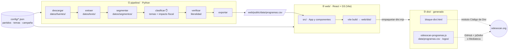

# Lee los programas · Elecciones Generales 29N

Herramienta de **ODESOCAN** (Observatorio de Derechos Sociales de Canarias) para la portada de [odesocan.org](https://odesocan.org) durante la campaña «**LEE, NO SE LO ESPERAN.**».

Permite comparar, en **18 temas**, las medidas de los programas electorales de **CC–1ºC, PP, PSOE, UPC y Vox**:

- Con su **texto literal**, verificado letra a letra contra el PDF oficial.
- Con un enlace a la página exacta del documento.
- Con el **peso** que cada partido da a cada tema: el % de su programa.

Se publica como un **bloque de código para Divi**: unas pocas líneas que se pegan en un módulo «Código».

| Programa | Estado | Medidas en la web |
|---|---|---|
| CC–1ºC · *Programa electoral 29N* | publicado | 100 |
| PP · *La reconstrucción nacional* | publicado | 241 (+ 8 «por anunciar») |
| PSOE · *La fuerza de seguir avanzando* | publicado | 500 |
| UPC · *Una sola papeleta. Todo un pueblo* (manifiesto facilitado por el partido) | publicado | 16 ejes |
| Vox · *Es sentido común* | publicado | 115 |

> La clasificación temática la hizo un agente de IA con reglas escritas y sigue **pendiente de revisión humana**. Los textos son 972 de 972 literales; el detalle está en [docs/INFORME-VOLCADO.md](docs/INFORME-VOLCADO.md). **La prueba de las cuentas (impacto fiscal) se descartó el 16-11-2026** y ya no se publica: los motivos están en [docs/CRITERIOS-IMPACTO-FISCAL.md](docs/CRITERIOS-IMPACTO-FISCAL.md).

---

## Arquitectura

El proyecto tiene tres módulos independientes, **una sola configuración** que comparten y un **script maestro** que los orquesta.



✋ = paso con intervención humana o de IA: la clasificación. Es lo único que no se reproduce solo.

### Principios

1. **Una sola fuente de verdad.** `config/` contiene partidos (siglas, colores, logos, URL y huella del PDF), temas y ajustes de campaña. La leen el pipeline y la web: nada se repite en dos sitios.
2. **Módulos con contrato.** Cada módulo solo se comunica con el siguiente mediante archivos de formato fijo (ver [Contratos](#contratos-entre-módulos)). Se puede rehacer la web sin tocar los datos, y al revés.
3. **Etapas idempotentes.** Cada etapa lee y escribe rutas fijas ([pipeline/rutas.py](pipeline/rutas.py)). Se puede ejecutar sola, en cualquier orden lógico y tantas veces como haga falta.
4. **Lo reproducible no se versiona; lo que no, sí.** Los PDF y el texto extraído se regeneran (están en `.gitignore`). Los segmentos, la clasificación y la hoja de revisión van a git, para poder revisar cada cambio.
5. **La literalidad es un invariante.** Una medida que no aparece letra a letra en el PDF no llega a la web, y `volcar` lo señala como error.
6. **`divi/` es solo salida.** Se borra y se regenera entera en cada `python3 maestro.py divi`.

### Estructura

```
├── README.md                    ← este documento
├── maestro.py                   ← script maestro: orquesta todas las etapas
├── requirements.txt             pypdf (versión fijada: la extracción depende de ella)
├── index.html                   página publicada en GitHub Pages (la genera `maestro.py divi`)
├── LICENSE                      licencia MIT del código
├── LICENSE-DATOS.md             CC BY 4.0 de los datos y documentos de ODESOCAN; qué es de terceros
├── .nojekyll                    GitHub Pages sirve los archivos tal cual
│
├── config/                      FUENTE ÚNICA DE VERDAD (la leen Python y la web)
│   ├── partidos.json            siglas, nombres, colores, logos, URL + SHA-256 del PDF oficial
│   ├── temas.json               las 18 temáticas: id, nombre y alcance (regla pública)
│   ├── fiscal.json              categorías de impacto fiscal (archivo: la prueba de las cuentas se descartó)
│   └── campana.json             fechas, aviso de boceto, enlaces, publicación en Divi
│
├── pipeline/                    ① DE LOS PDF AL CSV (Python ≥ 3.10)
│   ├── rutas.py                 todas las rutas del proyecto
│   ├── config.py                lectura de config/*.json
│   ├── texto.py                 utilidades comunes: ligaduras, glifos, «esqueleto» literal
│   ├── perfiles.py              cómo numera y maqueta sus medidas cada PDF (lo único por partido)
│   ├── apartados.py             en qué capítulo y apartado del programa está cada medida
│   ├── descargar.py             etapa 1 · PDF oficiales + control de versiones por huella
│   ├── extraer.py               etapa 2 · texto por página, con caché
│   ├── segmentar.py             etapa 3 · medidas numeradas; avisa de cambios
│   ├── clasificar.py            etapa 4 · dos dimensiones (temas, fiscal): preparar, validar, revisión
│   ├── contraste.py             control de calidad fiscal: señales del texto frente a etiquetas
│   ├── verificar.py             etapa 5 · cada texto está literalmente en el PDF
│   ├── exportar.py              etapa 6 · CSV de la web, hoja de revisión, informe
│   ├── igds.py                  índice de garantía de derechos sociales (en prueba, sin visualizar)
│   ├── igds_validacion.py       muestra para la validación humana del IGDS y concordancia
│   ├── obsidian.py              enlaces de los md en el vault de Obsidian (PE_29N) y su frontmatter
│   └── estado.py                resumen por partido
│
├── datos/
│   ├── fuentes/                 PDF oficiales (no van a git: se descargan)
│   ├── texto/                   caché de extracción (no va a git)
│   ├── segmentos/{id}.jsonl     una medida por línea
│   ├── clasificacion/{id}.json  temas de cada medida (IA + revisión humana)
│   ├── fiscal/{id}.json         impacto fiscal de cada medida (archivo, ya no se publica)
│   ├── revision/                revision-clasificacion.csv: hoja de trabajo del equipo
│   ├── igds/                    IGDS: fase0.json, codificacion/ (IA), ajustes.json (coherencia),
│   │                            validacion/ (hojas A, B y C para el equipo), igds-medidas.csv,
│   │                            igds-areas.csv, igds-resultados.json (lotes/ no va a git)
│   └── informes/                verificacion.json (qué se volcó y recuento por tema)
│                                contraste-fiscal.md (qué revisar), igds.md, igds-contraste.md
│                                e igds-validacion.md
│
├── web/                         ② LA HERRAMIENTA (React 18 + D3 7 · Vite 5)
│   ├── index.html               portada simulada para desarrollo
│   ├── src/
│   │   ├── embed.jsx            punto de entrada: monta la app en un Shadow DOM
│   │   ├── App.jsx              estado global, URL compartible, navegación
│   │   ├── config.js            adapta config/*.json para los componentes
│   │   ├── datos.js             carga y normaliza el CSV; índices y métrica relativa
│   │   ├── util.js              formato, colores accesibles, URL, compartir
│   │   ├── estilos.css          sistema visual .np (aislado en el Shadow DOM)
│   │   └── componentes/         Hero · CuentaAtras · SelectorTemas · VistaTema
│   │                            MapaProgramas · Cierre · LogoPartido
│   ├── public/data/programas.csv  ← lo escribe el pipeline (contrato ①→②)
│   ├── public/logos/            logos oficiales (cuando lleguen)
│   ├── scripts/empaquetar-divi.mjs   ③ monta divi/
│   ├── vite.config.js           servidor de desarrollo
│   └── vite.divi.config.js      build en un solo archivo JS (IIFE)
│
├── divi/                        ③ SALIDA PARA LA WEB (generada)
│   ├── bloque-divi.html         ← EL BLOQUE LIMPIO: lo que se pega en Divi
│   ├── odesocan-programas.js    la herramienta en un solo archivo (≈ 260 KB)
│   ├── data/programas.csv       los datos
│   ├── logos/                   (si hay logos oficiales)
│   ├── bloque-divi-autocontenido.html   alternativa sin alojar nada (no va a git)
│   └── prueba/                  páginas con CSS «hostil» de tema WordPress (no van a git)
│
└── docs/
    ├── DISENO.md                    resumen del diseño: relato, sistema visual, componentes, métricas
    ├── CRITERIOS-CLASIFICACION.md   reglas de clasificación temática (las mismas para todos)
    ├── CRITERIOS-IMPACTO-FISCAL.md  reglas de la prueba de las cuentas (descartada el 16-11-2026)
    ├── CRITERIOS-IGDS.md            libro de códigos del IGDS y reglas operativas (prueba)
    ├── ANALISIS-IGDS.md             análisis previo de los resultados del IGDS, antes de visualizarlo
    ├── VALIDACION-IGDS.md           instrucciones para validar el IGDS (hojas A, B y C)
    └── INFORME-VOLCADO.md           fuentes, método, incidencias y casos dudosos
```

### Contratos entre módulos

| Archivo | Lo escribe | Lo lee | Formato |
|---|---|---|---|
| `config/*.json` | el equipo | pipeline y web | ver el campo `_leeme` de cada archivo |
| `datos/segmentos/{id}.jsonl` | `segmentar` | `clasificar`, `exportar` | `id` (`pp-083`), `partido`, `ref`, `pagina`, `apartado` (lista: capítulo › apartado), `titulo`, `texto`, `aviso`, `piezas?` |
| `datos/clasificacion/{id}.json` | IA / equipo (`clasificar revision`) | `exportar` | `{"pp-083": ["tema principal", "otro"]}` (de 1 a 3 temas) |
| `datos/fiscal/{id}.json` | IA / equipo (`clasificar revision`) | `exportar` (solo la hoja de revisión) | `{"pp-083": ["menos_ingresos"]}` (de 0 a 4 etiquetas; `[]` = sin impacto). Archivo: ya no se publica |
| `web/public/data/programas.csv` | `exportar` | web ([datos.js](web/src/datos.js)) | `partido, tema, ref, pagina, titulo, texto, url, nota`. `tema` lleva los ids separados por `;`, con el principal primero. Desde el 16-11-2026 no lleva la columna `fiscal` |
| `divi/*` | `empaquetar-divi.mjs` | WordPress / Divi | ver [Publicar en Divi](#publicar-en-divi) |

La web solo conoce `programas.csv` y `config/`. Por eso también acepta un CSV hecho a mano o una Google Sheet publicada como CSV, siempre que tenga esas columnas.

---

## Puesta en marcha

Hace falta:

- **Python ≥ 3.10**, con `pypdf`.
- **Node.js ≥ 20**: solo para compilar la web.

```bash
python3 -m pip install -r requirements.txt
```

```bash
python3 maestro.py descargar
```

```bash
python3 maestro.py
```

La segunda orden baja los PDF oficiales y comprueba su huella. La tercera hace todo el recorrido: extraer, segmentar, validar, volcar, generar `divi/` y mostrar el estado. La primera vez instala también las dependencias de la web (`npm ci`).

## Script maestro

```text
python3 maestro.py [etapa] [opciones]
```

| Etapa | Qué hace |
|---|---|
| `todo` *(por defecto)* | extraer → segmentar → validar la clasificación → volcar → divi → estado |
| `estado` | Tabla por partido: PDF, medidas, medidas clasificadas y filas en la web. Indica si `divi/` está al día |
| `descargar` | Baja los PDF oficiales y avisa si un partido **cambia su programa** (no sobrescribe el verificado) |
| `extraer` | PDF → texto por página (caché en `datos/texto/`; `--forzar` para rehacerla) |
| `segmentar` | Texto → medidas. Dice qué números faltan, cuáles parecen cortadas y qué cambió respecto a la versión anterior |
| `clasificar preparar` | Escribe el lote y las instrucciones para clasificar un programa nuevo (`--dimension temas` o `fiscal`) |
| `clasificar validar` | Etiquetas válidas en las dos dimensiones, sin que falten ni sobren medidas |
| `clasificar revision` | Aplica las correcciones de la hoja de revisión (temas y fiscal) |
| `clasificar contrastar` | Lista dónde las señales del texto no casan con la etiqueta fiscal (`datos/informes/contraste-fiscal.md`) |
| `volcar` | Verifica la literalidad y escribe el CSV de la web, la hoja de revisión y el informe |
| `igds fase0` | IGDS (prueba): ¿se lee completo cada programa? Páginas, apartados, páginas sin texto, prosa fuera de las medidas |
| `igds preparar` | Lotes de codificación: medidas numeradas mezcladas por tema entre formaciones, más la prosa de cada programa. Si ya hay lotes, solo añade los de las formaciones nuevas (`--partido psoe`), con números nuevos |
| `igds validar` | Esquema, fragmento literal (≤ 25 palabras), DEC → EXI 0, REG → g 0, justificación de cada 0 (`--lote lote-01`) |
| `igds contrastar` | Medidas con g = 1, regresivas, señales que no casan y posibles repeticiones (`datos/informes/igds-contraste.md`) |
| `igds calcular` | Índices globales y por área con numerador y denominador, control de calidad, CSV e informe (`datos/informes/igds.md`) |
| `igds muestra` | Hojas de validación humana en `datos/igds/validacion/` (muestra fija; una formación nueva se añade al final sin tocar las filas anteriores; no sobrescribe trabajo salvo con `--forzar`) |
| `igds concordancia` | Acuerdo y kappa entre la codificación y la validación humana (`datos/informes/igds-validacion.md`) |
| `obsidian` | Enlaza los md del proyecto en el vault de Obsidian (subcarpetas `PE_29N`) y avisa si alguno dejó de ser un enlace |
| `divi` | Compila la web y regenera `divi/` |
| `servir` | Servidor de desarrollo en http://127.0.0.1:5173 |
| `probar` | Sirve `divi/` con el CSS de un tema WordPress agresivo, en http://127.0.0.1:4173 |

Opciones:

- `--partido ID`: limita la etapa a uno o varios partidos (se puede repetir).
- `--descargar`: hace que `todo` empiece comprobando los PDF.
- `--aceptar`: hace que `descargar` adopte la versión nueva de un PDF.
- `--lote lote-NN`: hace que `igds validar` compruebe solo ese lote.

El script devuelve un código distinto de 0 si algo falla, así que sirve también para automatizar.

---

## Flujos de trabajo

### Publicar en Divi

`divi/bloque-divi.html` es el **bloque limpio**: un comentario, un contenedor y un script. Necesita que `odesocan-programas.js` y `data/programas.csv` estén publicados en alguna URL, junto con `data/programa-upc-29n.pdf` (el manifiesto de UPC no tiene versión en línea y la web enlaza esa copia). Esa URL va en `config/campana.json → publicacion.base_url`.

**Publicación en uso · GitHub Pages** (desde el 16-11-2026)

- **Repositorio público:** https://github.com/Odesocan/elecciones-29n
- **Página publicada:** https://odesocan.github.io/elecciones-29n/. Es el `index.html` de la raíz, que genera `python3 maestro.py divi`; muestra la herramienta completa con los mismos archivos que usa Divi.
- **Base de los archivos para Divi:** `https://odesocan.github.io/elecciones-29n/divi/` (`config/campana.json → publicacion.base_url`).

1. En WordPress, edita la portada con Divi:
   1. Añade un módulo **Código**.
   2. Pega el contenido de `divi/bloque-divi.html`.
   3. Guarda.
2. **Actualizar los datos o la web:**
   1. Ejecuta `python3 maestro.py`, o la etapa que toque, y después `python3 maestro.py divi`.
   2. Haz `git commit` y `git push`. GitHub Pages publica en 1-2 minutos, sin purgar cachés.

   El bloque de Divi no se toca.
3. **Congelar una versión** (por ejemplo, tras el 29-N): `git tag v1.0.0` y `git push --tags`. Para servir esa versión fija, se puede usar jsDelivr: `https://cdn.jsdelivr.net/gh/Odesocan/elecciones-29n@v1.0.0/divi/` en `base_url`, y regenerar el bloque.
4. **Comprobar la página en local:** `npm --prefix web run publica` sirve la raíz del proyecto como en GitHub Pages, en http://127.0.0.1:4181.

**Alternativa · jsDelivr.** Con `base_url` en `https://cdn.jsdelivr.net/gh/Odesocan/elecciones-29n@main/divi/` también funciona, pero jsDelivr guarda la rama en caché hasta 12 horas. Para refrescarla, hay que abrir `https://purge.jsdelivr.net/gh/Odesocan/elecciones-29n@main/divi/odesocan-programas.js` y lo mismo con `data/programas.csv`.

**Opción B · Mediateca de WordPress.**

1. Sube `odesocan-programas.js` y `programas.csv` a *Medios*. Los logos, si los hay, también. Si los subes juntos, quedan en la misma carpeta (`…/wp-content/uploads/AAAA/MM/`).
2. Pon esa carpeta en `base_url`. Como en la Mediateca el CSV no está en `data/`, ajusta la línea `data-src` del bloque.
3. Para subir `.js`, WordPress exige una cuenta de administración.

**Opción C · Autocontenido.** `divi/bloque-divi-autocontenido.html` lleva dentro el JS y los datos en base64 (≈ 700 KB). No hay nada que alojar, pero cada cambio obliga a volver a pegarlo, y pesa en el editor de Divi.

**Ajustes del bloque** (en `config/campana.json → publicacion`):

- `margen_cabecera`: alto en px de la cabecera fija del tema + 16.
- `hero: false`: si la portada ya lleva el cartel encima.

Sin logos oficiales, el bloque usa `data-logos="ninguno"` y se ve un cuadrado con el color de cada partido.

**Por qué no se rompe dentro de Divi:**

- La herramienta vive en un **Shadow DOM**: los estilos del tema no le llegan y los suyos no salen.
- Se adapta al ancho de la columna (`@container`), no de la ventana.
- Puedes comprobarlo con `python3 maestro.py probar`.

### Subir a GitHub

El proyecto está en https://github.com/Odesocan/elecciones-29n (público, rama `main`, GitHub Pages desde la raíz). Para publicar cambios:

```bash
git add -A
```

```bash
git commit -m "Describe el cambio"
```

```bash
git push
```

El `.gitignore` deja fuera:

- Los PDF de los programas con versión en línea (≈ 96 MB): se recuperan con `python3 maestro.py descargar`, que comprueba la huella. El de UPC sí se versiona, porque no tiene URL de la que bajarlo.
- Las cachés.
- `node_modules`.
- Las versiones pesadas o de prueba de `divi/`.

### Revisar la clasificación

1. Abre `datos/revision/revision-clasificacion.csv` en Excel. El separador es «;».
2. En cada fila:
   - Marca `revisado_ok` si los temas están bien.
   - O escribe en `correccion` los temas correctos, con el principal primero. Ejemplo: `vivienda;economia`.
   - Las columnas `impacto_fiscal` y `correccion_fiscal` se conservan como archivo: la prueba de las cuentas se descartó el 16-11-2026 y no hace falta revisarlas.
   - La columna `apartado` dice en qué capítulo y apartado del programa está la medida. Sirve de contexto, sobre todo en las viñetas breves del PSOE, pero el tema lo decide lo que la medida hace.
3. Aplica las correcciones:
   ```bash
   python3 maestro.py clasificar revision
   ```
4. Regenera todo:
   ```bash
   python3 maestro.py
   ```

Las columnas que escribe el equipo se conservan siempre. Los criterios están en [docs/CRITERIOS-CLASIFICACION.md](docs/CRITERIOS-CLASIFICACION.md). El modo boceto (`boceto.activo` y `boceto.aviso` en `config/campana.json`) está desactivado desde el 16-11-2026.

### Añadir un programa nuevo

1. En `config/partidos.json`, rellena `programa` del partido:
   ```json
   {"titulo": "…", "url": "https://…pdf", "archivo": "programa-psoe-29n.pdf", "sha256": "", "paginas": 0}
   ```
2. Descarga el PDF; la etapa guarda su huella y su número de páginas:
   ```bash
   python3 maestro.py descargar --partido psoe
   ```
   Si el partido facilita el documento y no hay versión en línea (como UPC), deja `"url": ""`, pon `"pdf_propio": true`, copia el PDF a `datos/fuentes/` y añádelo como excepción en `.gitignore`. `volcar` lo copia junto al CSV, `divi` lo publica en `data/` y la web enlaza esa copia. `descargar` solo comprueba que su huella no cambia.
3. Mira en el PDF cómo empieza cada medida y añade su `Perfil` en [pipeline/perfiles.py](pipeline/perfiles.py). Las instrucciones están al principio del archivo; copia el perfil más parecido. El del PSOE muestra las opciones para PDF difíciles: títulos de apartado sin mayúsculas, palabras partidas, viñetas de Word y números sueltos. El de UPC muestra un manifiesto con títulos sin punto en varias líneas (`titulo='lineas'` y `fin_titulo`).
   Indica también en `apartados` cómo marca el programa sus capítulos (índice con «Pág.», índice con puntos, índice con sangría o cabeceras en el texto; ver [pipeline/apartados.py](pipeline/apartados.py)). Si ninguna forma encaja, añade una nueva allí.
4. Segmenta y repite ajustando el perfil hasta que no falten números ni haya cortes raros, y hasta que todas las medidas tengan apartado:
   ```bash
   python3 maestro.py segmentar --partido psoe
   ```
5. Prepara los lotes de las dos dimensiones:
   ```bash
   python3 maestro.py clasificar preparar --dimension todas --partido psoe
   ```
6. Da cada archivo de instrucciones a un agente de IA (o a una persona):
   - `datos/clasificacion/lotes/instrucciones-psoe.md` → escribirá `datos/clasificacion/psoe.json`.
   - `datos/clasificacion/lotes/instrucciones-fiscal-psoe.md` → escribirá `datos/fiscal/psoe.json`.
7. Valida la clasificación y revisa los casos que señale el contraste:
   ```bash
   python3 maestro.py clasificar validar --partido psoe
   ```
   ```bash
   python3 maestro.py clasificar contrastar --partido psoe
   ```
8. Regenera todo y publica:
   ```bash
   python3 maestro.py
   ```
9. Anota en [docs/INFORME-VOLCADO.md](docs/INFORME-VOLCADO.md) las incidencias y los casos dudosos.

En la web, el partido deja de figurar como «pendiente» en cuanto tiene medidas en el CSV.

### Si un partido cambia su PDF

`python3 maestro.py descargar` compara la huella del PDF de su web con la que se verificó. Si cambia, guarda el nuevo como `….nuevo.pdf` y **no toca el verificado**. Después de revisarlo:

1. Adopta la versión nueva:
   ```bash
   python3 maestro.py descargar --partido ID --aceptar
   ```
2. Vuelve a segmentar:
   ```bash
   python3 maestro.py segmentar --partido ID
   ```
   La salida lista qué medidas cambian, aparecen o desaparecen.
3. Revisa la clasificación de esas medidas y regenera todo:
   ```bash
   python3 maestro.py
   ```

### Cambios habituales sin tocar código

| Quiero… | Dónde |
|---|---|
| Cambiar un color o un logo | `config/partidos.json`; los logos (PNG o WebP) van en `web/public/logos/` |
| Cambiar el texto o el alcance de un tema | `config/temas.json` |
| Cambiar fechas, aviso, contacto o artículos visibles | `config/campana.json` |
| Actualizar la fecha de «última comprobación» de los pendientes | `config/campana.json → fecha_comprobacion` |

Después de cualquier cambio, ejecuta `python3 maestro.py divi`.

### Editar los documentos en Obsidian

Los md del proyecto están en el vault de ODESOCAN (`OBSERVATORIO/Obsidian`) con el ID **PE_29N** (Programa Electoral del 29 de noviembre). Cada uno está en una subcarpeta `PE_29N` dentro de la carpeta del vault que le corresponde. El índice del proyecto en el vault es `1_investigacion/01_proyectos/PE_29N/00_indice_PE_29N.md`.

| Carpeta del vault | Documentos |
|---|---|
| `1_investigacion/01_proyectos/PE_29N` | este README (como `PE_29N_README`) y el índice del proyecto |
| `1_investigacion/03_metodologia/PE_29N` | CRITERIOS-CLASIFICACION, CRITERIOS-IMPACTO-FISCAL, CRITERIOS-IGDS, VALIDACION-IGDS |
| `4_extracionpdf/PE_29N` | INFORME-VOLCADO |
| `7_visualizacion/PE_29N` | DISENO |
| `8_analisis/PE_29N` | ANALISIS-IGDS y los informes generados (igds, igds-contraste, igds-validacion, contraste-fiscal) |

- **Son enlaces simbólicos, no copias.** Editar en Obsidian es editar el archivo del proyecto. Lo que regenera el pipeline se ve en Obsidian; si una nota abierta no se actualiza, se cierra y se vuelve a abrir.
- **Frontmatter:** cada md lleva el frontmatter del vault (`type`, `fase`, `proyecto: PE_29N`, `tags`, `status`, `actualizado`, `aliases`, `fuente`), que el vault usa para su catálogo. Los informes generados lo reciben del propio pipeline ([pipeline/obsidian.py](pipeline/obsidian.py)). Al copiar los criterios en las instrucciones de quien clasifica, se quita.
- **Los informes generados no se editan:** el pipeline los reescribe en cada ejecución.
- **Enlaces:** los enlaces entre documentos con ruta del proyecto (`docs/…`, `../datos/informes/…`) y los que llevan a código o datos no se abren en Obsidian. Para navegar en el vault, mejor el índice `00_indice_PE_29N`.
- **Comprobación:** `python3 maestro.py estado` dice si las 12 notas siguen enlazadas. Si un programa sustituyó un enlace por una copia, `python3 maestro.py obsidian` lo señala, y recrea los enlaces que falten (por ejemplo, un md nuevo añadido a `ENLACES` en [pipeline/obsidian.py](pipeline/obsidian.py)).
- **Git del vault:** el repo del vault guarda los enlaces, no el texto, que se versiona aquí. Al hacer commit en el vault, su hook regenera el catálogo (`_meta/gen_catalogo.py`).
- No están en el vault las instrucciones de los lotes de clasificación (`datos/clasificacion/lotes/`). Son temporales y repiten los criterios.

---

## Decisiones de diseño

- **Neutralidad.**
  - Partidos en orden alfabético por sigla.
  - Colores y logos de cada partido solo donde se habla de él; el marco es siempre de ODESOCAN.
  - Un programa no publicado aparece como «pendiente de publicar», nunca como «no propone nada».
- **Métrica relativa.** El mapa, las barritas y las barras muestran el **peso** de cada tema: el % de las medidas de cada programa que lo tratan.
  - El recuento absoluto premiaba al programa más largo (241 medidas frente a 100).
  - Una medida puede tener hasta 3 temas, así que los porcentajes de un programa suman más de 100.
  - El número de medidas se muestra como base («18 de 241 medidas»).
  - Cada bloque de partido indica el puesto del tema en su programa.
  - El cálculo está en `indexar()` ([web/src/datos.js](web/src/datos.js)).
- **Peso ≠ calidad.** Se repite en el mapa y en las barras: lo que dicen solo se sabe leyendo.
- **Cierre.** Solo la franja de campaña «Lee. Compara. Decide.» con el botón de compartir. La cita, la lista de PDF y el apartado de método se quitaron a petición del equipo el 14-11-2026. Los PDF siguen enlazados en el bloque de cada partido y en cada medida, y el método está en este README y en docs/.
- **La prueba de las cuentas: descartada el 16-11-2026.** Contaba, por partido, las medidas que restan y las que suman dinero a las cuentas públicas, con un ratio «1 : x» y una etiqueta roja de «Riesgo de viabilidad». El equipo la descartó por tres motivos:
  1. es difícil de interpretar;
  2. una de sus lecturas principales puntúa en positivo la austeridad económica, al margen de la garantía de derechos;
  3. otra lectura anima a la abstención, porque todos los programas llevaban la alerta de riesgo de viabilidad.

  Se quitaron de la web la sección, las etiquetas de cada medida y la regla de riesgo, y del CSV publicado, la columna `fiscal`. La clasificación fiscal (`datos/fiscal/`) y sus criterios se conservan como archivo.
- **Literalidad.** Solo se publican textos que aparecen letra a letra en el PDF oficial. Las erratas del original se respetan.
- **Accesibilidad.**
  - Objetivos táctiles ≥ 44 px, `aria-pressed` y región `aria-live`.
  - Foco gestionado y navegación del mapa con flechas.
  - Cuenta atrás sin botón de pausa, por decisión del equipo (14-11-2026). Se avisó de que WCAG 2.2.2 lo pide para contenido que se actualiza solo. Lo que se mantiene: con `prefers-reduced-motion` se actualiza cada minuto y sin segundos, y el lector de pantalla lee una frase estable. También hay modo de alto contraste.
  - Contraste AA también sobre los colores de partido.
- **URL compartible.** `?tema=vivienda&partidos=pp+vox` abre ese tema con esos partidos. Se usa `replaceState`, no `#`, porque Divi salta a las anclas.
- **Fuentes.** IBM Plex Sans/Mono (sistema `.np` de ODESOCAN) y Anton para el eco del cartel, desde Google Fonts. Si la web las aloja en local por RGPD, quita `cargarFuentes()` de [web/src/embed.jsx](web/src/embed.jsx).

## Licencia

- **Código** (`maestro.py`, `pipeline/`, `web/` y lo que genera en `divi/` e `index.html`): [MIT](LICENSE).
- **Datos, clasificaciones, criterios y documentación de ODESOCAN:** [CC BY 4.0](https://creativecommons.org/licenses/by/4.0/deed.es). Se pueden reutilizar citando a ODESOCAN.
- **No los cubre ninguna licencia:** los textos literales de los programas, el manifiesto de UPC y los logos. Son de cada partido y coalición.

El detalle, con la atribución sugerida, está en [LICENSE-DATOS.md](LICENSE-DATOS.md).

## Pendiente

- [ ] Confirmar el color de CC–1ºC. Los demás salen de sus logos oficiales (14-11-2026): PP #1E4B8F, PSOE #DA0200, Vox #5AC035 y UPC #3D9E9A (la «P», no el amarillo). CC–1ºC mantiene el amarillo #FFC800, común a sus dos logos.
- [ ] Revisión humana de la clasificación temática. El equipo hizo una revisión parcial (16-11-2026) y pidió dos temas nuevos, «infancia» e «idi», ya creados. Queda revisar el resto, empezando por los casos dudosos de [docs/INFORME-VOLCADO.md](docs/INFORME-VOLCADO.md): el reparto de «administraciones» entre `estado` y `justicia`, y las 71 medidas de los temas nuevos.
- [x] Revisión humana de la clasificación fiscal: hecha por el equipo el 16-11-2026 en los cuatro programas cargados. Ese mismo día se descartó la prueba de las cuentas, así que la de UPC ya no hace falta revisarla.
- [ ] IGDS (prueba): rellenar las hojas de validación de `datos/igds/validacion/` siguiendo [docs/VALIDACION-IGDS.md](docs/VALIDACION-IGDS.md) (la A, primero y a ciegas), ejecutar `igds concordancia` y decidir los 8 puntos abiertos del libro de códigos ([docs/ANALISIS-IGDS.md](docs/ANALISIS-IGDS.md)); después, decidir su visualización.
- [x] UPC: su manifiesto, facilitado directamente por el partido como único documento programático, se cargó el 16-11-2026 (16 ejes) y se codificó en el IGDS el mismo día (lotes 23 y 24: N 75, IGDS 0,0, declarativas 70,7 %). Falta que el equipo revise su clasificación temática y validar su codificación del IGDS con el resto (hojas A y C).
- [x] Revisión cruzada de la clasificación del PSOE (temas y fiscal), hecha el 16-11-2026: se leyeron las 500 medidas y se compararon con las equivalentes de los otros tres programas. El resultado está en [docs/INFORME-VOLCADO.md](docs/INFORME-VOLCADO.md).
- [x] Repositorio público y publicación: https://github.com/Odesocan/elecciones-29n con GitHub Pages (16-11-2026); `publicacion.base_url` apunta a `https://odesocan.github.io/elecciones-29n/divi/`.
- [x] Licencia del repositorio (16-11-2026): código MIT y datos y documentación de ODESOCAN CC BY 4.0. Los textos de los programas, el PDF de UPC y los logos quedan fuera ([LICENSE-DATOS.md](LICENSE-DATOS.md)).
